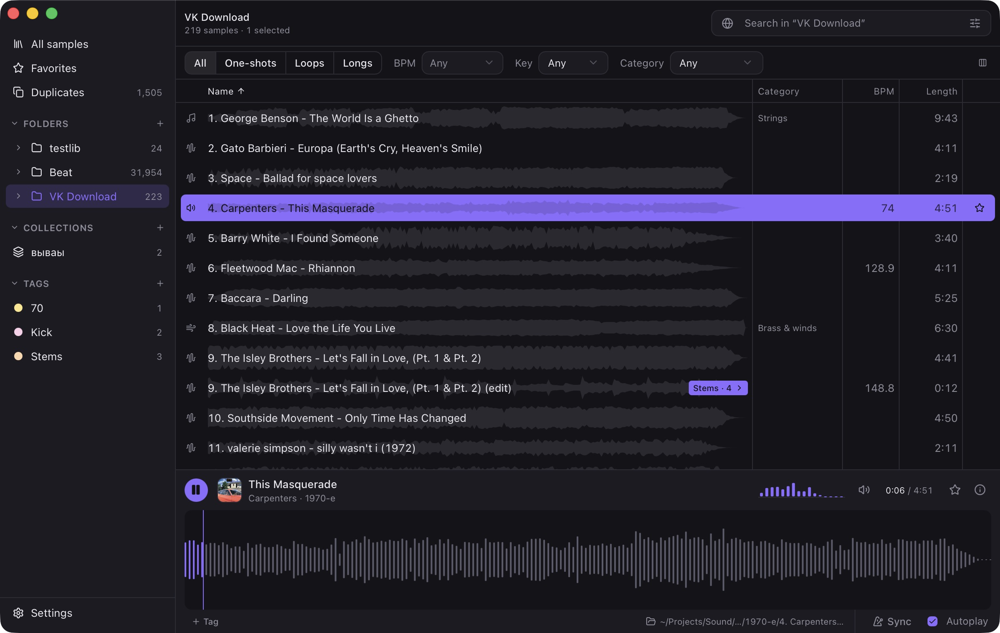
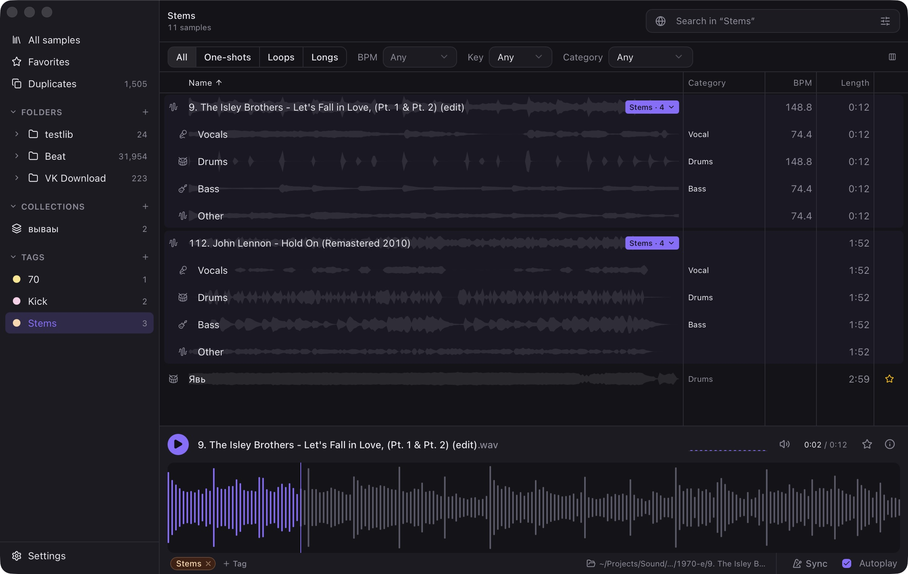
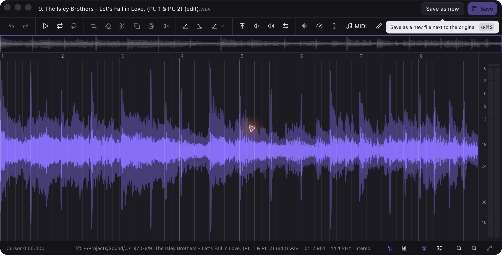
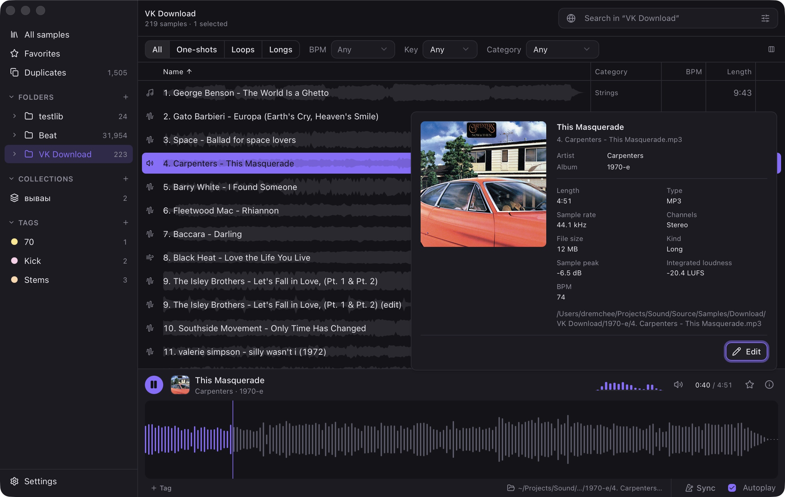

# Fonicca

A desktop app for browsing, organizing and shaping your local audio library.

Find a sound, audition it, edit a fragment or separate a track into stems — in one workspace. Fonicca works with your own audio files and runs audio analysis and processing on your computer.

[Download releases](https://github.com/dremchee/fonicca/releases) · [Release notes](docs/releases/v0.1.0.md) · [Build and release guide](docs/builds.md)



## What you can do

- **Organize your library.** Browse folders, create collections, add colored tags and favorites, and choose which table columns to show.
- **Find the right sound.** Search your library, filter by sound type, tempo, key and category, analyze audio, and find similar sounds.
- **Audition quickly.** Preview audio with customizable waveforms, zoom, level meters and project tempo/key sync. Cached waveforms also appear behind track names.
- **Clean up duplicates.** Compare copies in grouped or flat views, choose which to keep, and hide or move extra copies to the Trash.
- **Edit audio.** Select, trim, cut, fade, adjust gain, normalize, change pitch and timing, slice audio, and export regions.
- **Process multiple files.** Apply batch processing, convert formats and use filename templates.
- **Work with local models.** Separate stems, restore audio with Apollo, and convert audio to MIDI with Basic Pitch. Optional models download when needed.

Supported input formats include WAV, AIFF, FLAC, MP3, OGG, M4A and CAF. Decoding support can depend on the codec inside the file.

## A closer look

### Stems in context

Keep the original track and its separated parts together in an expandable group.



### Audio editor

Work directly on the waveform with an overview, selection tools, processing actions and level meters.



<details>
<summary>Track information</summary>

View cover art, metadata, audio properties and analysis results in the track information popover.



</details>

## Installation

Download an installer from [GitHub Releases](https://github.com/dremchee/fonicca/releases).

| Platform | Requirements | Package |
| --- | --- | --- |
| macOS | Apple Silicon, macOS 13.4+ | `.dmg` |
| Windows | x64 | `-setup.exe` or `.msi` |
| Linux | Ubuntu 24.04 or a compatible newer distribution, x64 | `.AppImage` or `.deb` |

Intel Macs are not supported by the current build. macOS packages are not notarized and Windows installers are not code-signed.

Install the first version manually. Published stable updates can then be checked from **Settings → About** on macOS, Windows and AppImage installations. Debian installations use the package manager. Updater signatures are separate from operating-system code signing.

## Getting started

1. Use **+** beside **Folders** to add an audio folder to your library.
2. Select a track to preview it. Use search and filters to narrow down the list.
3. Add tags, favorites or collections to organize sounds for a project.
4. Open a track's context menu for editing, analysis and processing tools.

Model downloads require an internet connection; audio processing stays local. Model quality, resource requirements and usage terms vary — review the information shown in the app before downloading or processing. Stem separation and audio-to-MIDI currently support mono/stereo files up to 10 minutes.

## Development

Fonicca uses **Tauri 2**, **Rust**, **Vue 3**, **TypeScript**, **Pinia** and **Vite**. The library is stored locally in SQLite, and ONNX Runtime runs the audio models.

### Prerequisites

- Node.js 26 and pnpm 9.10.0, matching CI and `package.json`.
- Rust stable and Cargo.
- The [Tauri platform prerequisites](https://v2.tauri.app/start/prerequisites/) for your operating system.

On Ubuntu 24.04, the native build also needs:

```sh
sudo apt-get update
sudo apt-get install --no-install-recommends -y \
  build-essential pkg-config libssl-dev libwebkit2gtk-4.1-dev \
  libayatana-appindicator3-dev librsvg2-dev libasound2-dev libudev-dev
```

### Run the desktop app

```sh
git clone https://github.com/dremchee/fonicca.git
cd fonicca
pnpm install --frozen-lockfile
pnpm tauri dev
```

`pnpm dev` starts only the frontend development server. Use `pnpm tauri dev` for the desktop app and its native audio and library features.

### Check and build

```sh
pnpm test
pnpm build
cargo test --manifest-path src-tauri/Cargo.toml --locked --lib
pnpm tauri build --ci -- --locked
```

The first native build downloads dependencies and the ONNX Runtime distribution, so it can take a while. Build installers on their target operating system.

## Releases and project notes

Pushes and pull requests to `main` run tests and compilation checks. Matching version tags such as `v0.1.0` build installers for all three platforms and prepare a draft release for manual review and publication.

- [Builds, signing, automatic updates and release instructions](docs/builds.md)
- [Development plan and backlog](docs/plan.md)
- [Dependency and model license notes](docs/dependencies.md)
- [Current architecture and module boundaries](docs/architecture.md)
- [Refactoring plan and performance measurements](docs/refactoring.md)
- [Third-party notices](docs/licenses/)

## Feedback

Found a bug or missing a workflow? [Open an issue](https://github.com/dremchee/fonicca/issues) with your app version, operating system and steps to reproduce it. For audio-specific problems, include the file format and a small example you have permission to share.
