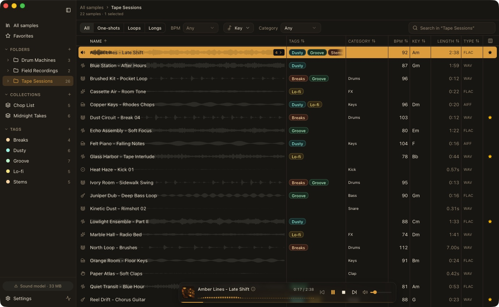
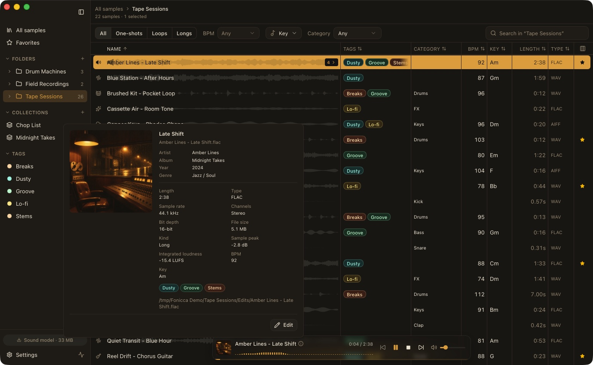
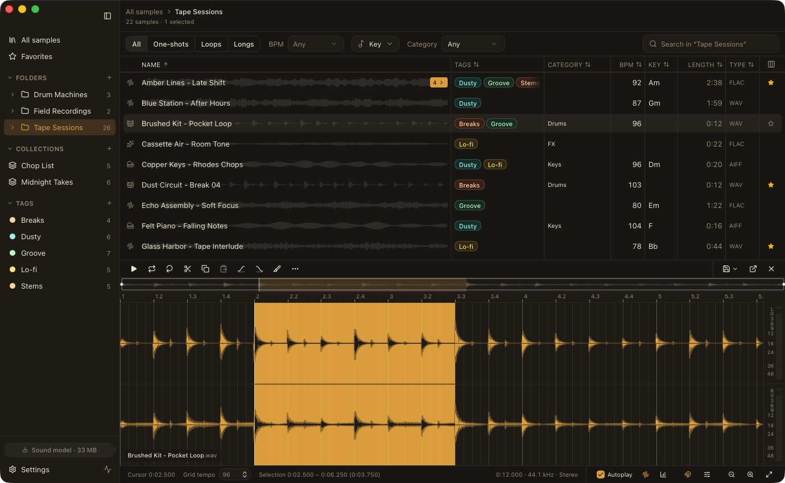
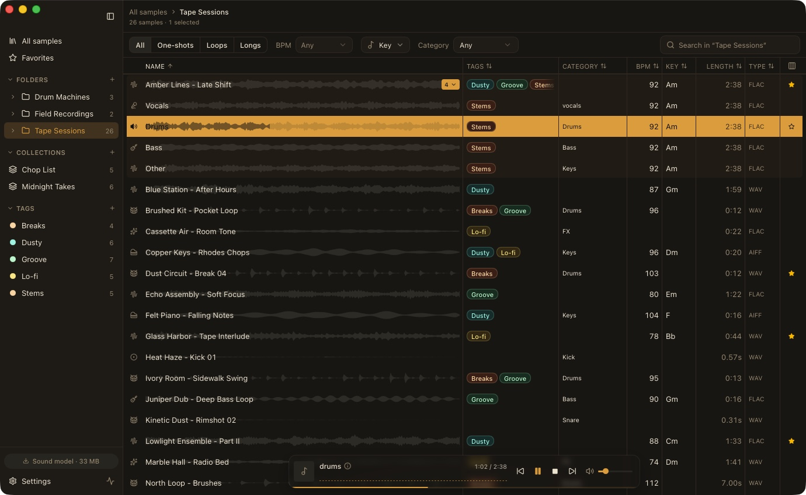

# Руководство по Fonicca

Fonicca помогает прослушивать, организовывать и редактировать аудио. Приложение индексирует существующие папки и хранит данные библиотеки на вашем компьютере.

[Первый запуск](#get-started) · [Библиотека](#browse-and-organize) · [Прослушивание](#preview-audio) · [Редактор](#edit-and-export) · [Стемы](#separate-stems) · [Обработка](#process-audio) · [Данные](#manage-your-data) · [Настройки](#settings) · [Клавиши](#keyboard-shortcuts) · [Решение проблем](#troubleshooting)

## Первый запуск {#get-started}

1. [Установите Fonicca](installation.md). Нажмите **+** рядом с разделом **Папки** и выберите каталог, в котором уже лежит аудио. Fonicca просканирует каталог и его подпапки. Файлы останутся на своих местах.
2. Откройте папку в боковой панели. Семплы появляются по мере сканирования. Фоновый анализ заполняет темп, тональность и громкость, когда их удаётся определить. Слушать семплы можно уже во время анализа.
3. Щёлкните по семплу, чтобы прослушать его в мини-плеере. Двойной щелчок откроет редактор под библиотекой.
4. Чтобы создать отдельный клип, выделите часть волны перетаскиванием. В меню сохранения выберите **Сохранить выделение…**, укажите формат, частоту дискретизации и куда сохранить файл.

Fonicca читает WAV, AIFF, FLAC, MP3, OGG, M4A и CAF. Возможность открыть файл также зависит от его кодека.

## Библиотека и поиск {#browse-and-organize}

- **Папки.** Разверните папку на боковой панели, чтобы увидеть вложенные каталоги. Путь над таблицей позволяет перейти в родительскую папку или в раздел **Все семплы**. Щёлкните по исходной папке правой кнопкой, чтобы **Пересканировать** или **Убрать из библиотеки**. При удалении папки из библиотеки её файлы остаются на диске.
- **Поиск и фильтры.** Поиск работает в текущей папке или разделе. Чтобы искать по всей библиотеке, откройте **Все семплы**. Фильтры **Ван-шоты**, **Лупы** и **Длинные** ограничивают список по типу звука. Дополнительно задайте диапазон BPM, тональность или категорию. Кнопка **Сбросить** очищает фильтры анализа.
- **Колонки.** Щёлкните заголовок для сортировки. Перетащите границу между заголовками, чтобы изменить ширину. В меню **Колонки** в последнем заголовке можно показать или скрыть поля и восстановить ширину колонок.
- **Избранное.** Нажмите звёздочку в строке или клавишу **F**. Отмеченные семплы собраны в разделе **Избранное**.
- **Коллекции.** Нажмите **+** рядом с разделом **Коллекции** или выберите семплы и откройте **Добавить в коллекцию** в контекстном меню. В коллекцию можно добавить семплы из разных папок. Чтобы исключить семпл из коллекции, откройте её и выберите **Убрать из «…»**.

Щёлкните по строке с **Shift**, чтобы выделить диапазон. С **Command** на macOS или **Ctrl** на Windows и Linux можно добавлять и исключать отдельные строки. Выделение используется при назначении тегов, добавлении в коллекцию, перетаскивании файлов и запуске пакетной обработки из контекстного меню выбранной строки.

### Работа с тегами {#work-with-tags}

| Задача | Действие |
| --- | --- |
| Добавить тег к одному семплу | Нажмите **+** в колонке **Теги**. Выберите существующий тег или введите название и выберите **Создать «…»**. |
| Добавить тег к нескольким семплам | Выделите строки и нажмите **T** или выберите **Добавить тег…** в контекстном меню. |
| Снять тег с одного семпла | Нажмите **+** в его строке и щёлкните нужный тег под заголовком **У этого семпла**. |
| Найти все семплы с тегом | Щёлкните по тегу в таблице или на боковой панели. |
| Переименовать, перекрасить или удалить тег | Воспользуйтесь элементами управления тегом на боковой панели. Удаление тега здесь снимает его со всех семплов. |

### Поиск похожих звуков {#find-similar-sounds}

Загрузите **Звуковую модель** с боковой панели или через **Настройки → Анализ**. Дождитесь анализа нужного семпла, затем выберите **Найти похожие** в контекстном меню или нажмите **S**. Самые близкие по звучанию варианты будут в начале списка.

Например, возьмите понравившуюся бочку, запустите поиск похожих и прослушайте первые результаты. Подходящие звуки можно сразу собрать в коллекцию проекта. Модель загружается один раз и работает локально.

## Прослушивание {#preview-audio}

Плавающий мини-плеер показывает название трека, обложку при наличии, время и полосу воспроизведения. В нём можно остановить или приостановить трек, перейти к соседнему или изменить громкость. Щёлкните по полосе воспроизведения или перетащите указатель, чтобы перемотать. Саму панель тоже можно перетащить.

- Кнопка воспроизведения в строке запускает или приостанавливает трек. В режиме **С места клика** щелчок по уже загруженной волне начинает прослушивание с выбранной позиции. Изменить это поведение можно в разделе **Настройки → Аудио → Клик по треку**.
- Стрелки вверх и вниз перемещают фокус по списку. Параметр **Настройки → Аудио → Автовоспроизведение** определяет, запускается ли при этом звук.
- Нажмите **ⓘ** рядом с названием играющего трека, чтобы посмотреть формат, частоту дискретизации, уровень пика, громкость и метаданные. Кнопка **Редактировать** записывает поддерживаемые метаданные, например название и обложку, в аудиофайл. Теги библиотеки настраиваются отдельно в колонке **Теги**.
- Чтобы передать звуки в DAW, перетащите строку или группу выделенных строк в программу, которая принимает аудиофайлы таким способом. Громкость мини-плеера влияет только на прослушивание. В DAW попадут исходные файлы с их сохранённым уровнем.

## Редактирование и экспорт {#edit-and-export}

Дважды щёлкните по треку или выберите **Редактировать…** в контекстном меню. Редактор откроется под библиотекой. Для работы в отдельном окне нажмите **Открыть редактор в отдельном окне** на его панели.

1. Щёлкните по волне, чтобы поставить курсор. Протяните указатель по волне, чтобы выделить диапазон.
2. Нажмите **Пробел**, когда редактор в фокусе, чтобы прослушать выделение или начать с позиции курсора. Включите **Луп** для повторного прослушивания выделения. Чтобы записать границы петли при экспорте WAV, задайте **Точки лупа**.
3. Используйте кнопки вырезания, копирования, вставки, обрезки и фейдов. В меню **Дополнительные инструменты** и в контекстном меню волны доступны изменение усиления, нормализация, разворот, изменение тона и длительности. Кнопки **Отменить** и **Повторить** перемещают по истории правок.
4. Перетаскивайте видимую область по полосе обзора всего файла. В меню **Вид** можно переключить сетку на **Такты и доли**, **Время** или **Нет**. Для сетки по долям задайте **Темп сетки**.

Чтобы получить аккуратный фрагмент, приблизьте его границы и прослушайте выделение. Если слышен щелчок, выделите короткий участок у соответствующей границы и примените фейд. Команда **Обрезать** оставляет в редакторе выделенный участок. **Сохранить выделение…** записывает участок в отдельный файл, сохраняя полный трек открытым.

### Сохранение, нарезка и замена {#save-slice-or-replace}

| Команда | Результат |
| --- | --- |
| **Сохранить** | При первом сохранении Fonicca предложит место для файла. Следующие сохранения обновят выбранный файл с последней частотой экспорта. |
| **Сохранить как…** | Сохраняет всю отредактированную дорожку. Можно выбрать формат, частоту и место. |
| **Сохранить выделение…** | Записывает выделенный диапазон в новый файл. |
| **Сохранить регионы** | Записывает каждый включённый регион в отдельный WAV в папку рядом с треком. |
| **Заменить оригинал…** | Заменяет исходный WAV, когда команда доступна, и сохраняет резервную копию. |

Трек или выделение можно сохранить в WAV, MP3, Ogg Vorbis, FLAC, AIFF, M4A (ALAC) или CAF. Для переноса точек петли и маркеров нарезки выберите WAV.

Чтобы разделить трек на несколько клипов, поставьте маркеры клавишей **M** или двойным щелчком по линейке. Если есть выделение, **M** поставит маркеры на обеих границах. Перетащите маркеры, чтобы уточнить границы. Щелчок по региону на линейке выделяет его, а **Option / Alt** и щелчок исключают его из экспорта. Затем выберите **Сохранить регионы**.

Для автоматической разметки откройте **Нарезка**. Выберите **Сетка** для равных интервалов, **Удары** для перкуссии или **Тишина** для записи с паузами. Укажите, обрабатывать выделение или весь файл, настройте параметры, разместите маркеры и перед экспортом прослушайте регионы.

## Разделение на стемы {#separate-stems}

1. Щёлкните по исходному треку правой кнопкой и выберите **Обработка → Разделить на стемы…**.
2. Выберите **2 дорожки** для вокала и минуса или **4 дорожки** для вокала, барабанов, баса и остальных инструментов.
3. Выберите **Модель разделения** и проверьте **Формат сохранения**. Fonicca предлагает формат исходника, если он доступен для экспорта, либо WAV. В списке доступны те же семь форматов, что и в редакторе.
4. Проверьте **Папку результата**. По умолчанию рядом с исходником создаётся отдельная папка с названием трека. Расположение для новых стемов можно выбрать в разделе **Настройки → Анализ → Папка для стемов**.
5. Нажмите **Разделить** или **Скачать модель и разделить**. После завершения щёлкните по числу рядом с исходным треком, чтобы раскрыть стемы. Каждый из них можно отдельно прослушать или открыть в редакторе.

На вход принимается моно или стерео до 10 минут. Стемы сохраняются в стерео с частотой 44,1 кГц. Для скачивания модели нужен интернет, разделение выполняется локально. При выборе модели учитывайте размер загрузки, описание и [условия использования](https://github.com/dremchee/fonicca/blob/main/docs/dependencies.md).

## Обработка аудио {#process-audio}

| Задача | Откуда запустить | Результат |
| --- | --- | --- |
| Пакетная обработка | Выделите треки, щёлкните по одному из них правой кнопкой и выберите **Обработка → Обработать…**. | Один набор настроек для обрезки тишины, удаления DC offset, фейдов, нормализации по пику или LUFS и сохранения в WAV. |
| Восстановление музыки | Выберите **Обработка → Восстановить через Apollo…** в контекстном меню трека. | Обработка музыки после сжатия с потерями и отдельная WAV-копия 44,1 кГц, 32-bit float рядом с исходником. |
| Аудио в MIDI | Выберите **Обработка → Экспорт MIDI…** в контекстном меню трека или **Экспорт MIDI…** в редакторе. | Basic Pitch распознаёт ноты и сохраняет MIDI-файл для DAW. |

### Пакетная обработка семплов {#prepare-a-batch-of-samples}

1. Выделите файлы и откройте **Обработать…**. Включите нужные шаги. Например, чтобы укоротить паузы у серии ударных, включите **Обрезать тишину** и укажите порог и запас вокруг звука.
2. Для одинакового максимального уровня используйте нормализацию **По пику**, для воспринимаемой громкости выберите LUFS. Для LUFS нужно хотя бы 400 мс слышимого звука. В отчёте видно, когда результат ограничен потолком пиков.
3. При необходимости задайте число каналов, частоту и разрядность. Выберите **В папку**, чтобы записать новые WAV. Чтобы отличать обработанные файлы, укажите шаблон имени. Команда **Заменить оригиналы** доступна для входных WAV и сохраняет копии в папке резервных копий.
4. Нажмите **Обработать** и проверьте список записанных файлов и ошибки в отчёте. Если планируете повторять эту обработку, выберите **Сохранить как пресет…**.

### Восстановление трека и экспорт нот {#restore-a-track-or-export-notes}

Apollo и Basic Pitch принимают моно или стерео до 10 минут. При первом использовании приложение предложит загрузить нужную модель. Управление загрузками находится в разделе **Настройки → Анализ → Модели**.

- **Apollo.** Запустите восстановление и прослушайте **Оригинал** и **После Apollo** в окне результата. Готовую копию можно открыть в редакторе.
- **Basic Pitch.** Начните с записи одного мелодического инструмента, например баса, пианино или гитары. Если нужен фрагмент, выделите его в редакторе. Укажите, куда сохранить MIDI, а затем импортируйте файл на дорожку виртуального инструмента в DAW.

## Управление данными {#manage-your-data}

### Дубликаты и скрытые файлы {#duplicates-and-hidden-files}

Откройте **Дубликаты** на боковой панели, чтобы просмотреть группы одинаковых файлов. Выберите, какую копию оставить, или задайте правило, например **Самый короткий путь**. Проверьте выбранные группы перед применением.

**Скрыть из библиотеки** убирает записи о лишних копиях из списка, сохраняя файлы на диске. Действие **В Корзину** перемещает сами файлы в корзину операционной системы. Теги, избранное и коллекции обработанных копий объединяются на оставшейся копии.

Чтобы вернуть скрытый файл, откройте **Настройки → Библиотека → Скрытые файлы** и нажмите **Показать**. Чтобы вернуть удалённый файл, восстановите его из корзины системы и при необходимости пересканируйте исходную папку.

### Перенос избранного, тегов и коллекций {#export-favorites-tags-and-collections}

Откройте **Настройки → Библиотека → Ваши данные → Экспорт…**, чтобы записать избранное, теги и коллекции в JSON. При переносе на другой компьютер отдельно скопируйте аудиофайлы.

На новом компьютере добавьте и просканируйте папки с аудио, затем в том же разделе нажмите **Импорт…**. Импорт объединит данные с текущей библиотекой. Fonicca сопоставляет семплы сначала по пути, затем по содержимому.

Пути к базе библиотеки, файлу настроек и моделям доступны в разделе **Настройки → О программе → Хранилище**.

## Настройки {#settings}

| Раздел | Что можно изменить |
| --- | --- |
| **Основные** | Язык интерфейса и оформление. Можно выбрать светлую или тёмную тему либо использовать системное оформление. |
| **Библиотека** | Индексируемые папки, отслеживание изменений, скрытые файлы, импорт и экспорт данных. |
| **Аудио** | Выходное устройство, громкость прослушивания, поведение при клике и при переходе стрелками, вид индикатора уровня. |
| **Волна** | Отображение волны в предпросмотре и редакторе. |
| **Темы** | Цветовая палитра, например стандартная **Tape**. Можно создать собственную тему. |
| **Анализ** | Пауза и возобновление анализа, число потоков процессора, установка моделей и папка для стемов. |
| **Сочетания клавиш** | Список клавиш приложения. |
| **О программе** | Версия, проверка обновлений и пути к локальным данным. |

## Сочетания клавиш {#keyboard-shortcuts}

В командах ниже используйте **Command** на macOS или **Ctrl** на Windows и Linux. Буквенные клавиши указаны в латинской раскладке.

| В библиотеке | Действие |
| --- | --- |
| ↑ / ↓ | Перевести фокус. Добавьте **Shift**, чтобы расширить выделение. |
| Пробел | Воспроизвести или приостановить трек в фокусе. |
| Esc | Остановить прослушивание или выйти из поля поиска. |
| Command/Ctrl + A | Выделить все результаты в текущем разделе. |
| Command/Ctrl + F | Перейти к поиску. |
| Command/Ctrl + K | Открыть палитру команд для поиска треков, дубликатов и действий. |
| F / T | Переключить избранное / открыть выбор тега. |
| E / I / S | Открыть редактор / открыть информацию о треке / найти похожие звуки. |

| В редакторе | Действие |
| --- | --- |
| Пробел | Воспроизвести или приостановить аудио в редакторе. |
| Command/Ctrl + Z | Отменить. С **Shift** повторить. |
| Command/Ctrl + S | Сохранить. С **Shift** открыть **Сохранить как…**. |
| M | Поставить маркер у курсора или два маркера по краям выделения. |
| 1–9 / Shift + 1–9 | Воспроизвести регионы 1–9 / 10–18. |
| L / Shift + L | Включить или выключить повтор / задать или убрать точки лупа. |
| 0 | Показать всю волну целиком. |

## Решение проблем {#troubleshooting}

| Что произошло | Что проверить |
| --- | --- |
| Новый трек не появился | Очистите поиск и фильтры. Откройте исходную папку и выберите **Пересканировать**. Проверьте раздел **Настройки → Библиотека → Скрытые файлы**, если раньше скрывали этот файл. Перед сканированием подключите внешний диск по прежнему пути. |
| Нет BPM, тональности или категории | Проверьте ход анализа в **Настройки → Анализ** и возобновите его, если он на паузе. Темп и тональность зависят от материала. **Звуковая модель** помогает определять категорию по звучанию, если имя файла не даёт подсказок. |
| Поиск похожих недоступен | Загрузите **Звуковую модель** и дождитесь окончания анализа. |
| При прослушивании нет звука | Проверьте громкость мини-плеера и пункт **Настройки → Аудио → Устройство вывода**. Если переподключали аудиоинтерфейс, нажмите **Обновить устройства** и запустите воспроизведение снова. |
| Не удаётся разделить трек, восстановить его или экспортировать MIDI | Проверьте, что входной файл содержит один или два канала и длится до 10 минут, нужная модель установлена, а папка результата доступна для записи. Для длинной записи можно сначала сохранить нужный фрагмент через **Сохранить выделение…**. |

При обращении за помощью укажите версию из раздела **Настройки → О программе**, операционную систему, формат файла и шаги для воспроизведения проблемы. [GitHub Issues](https://github.com/dremchee/fonicca/issues)
