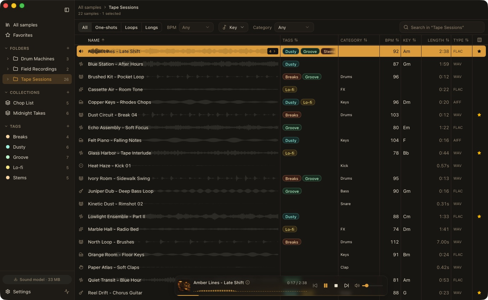
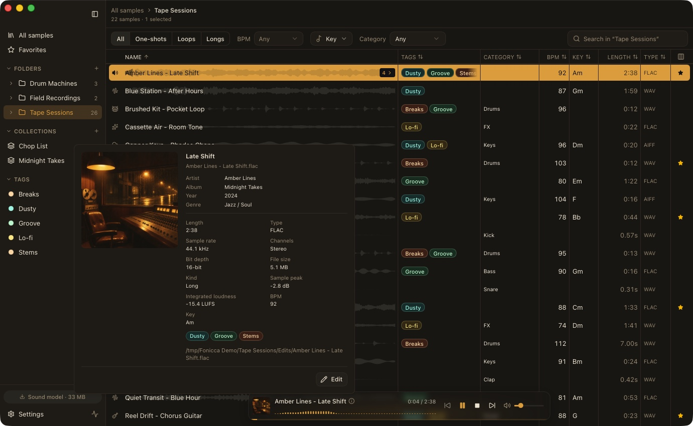

# Fonicca user guide

Fonicca is a desktop app for auditioning, organizing and editing local audio. It indexes your audio in its existing folders and keeps library data on your computer.

[Get started](#get-started) · [Browse and organize](#browse-and-organize) · [Preview audio](#preview-audio) · [Edit and export](#edit-and-export) · [Separate stems](#separate-stems) · [Process audio](#process-audio) · [Manage your data](#manage-your-data) · [Settings](#settings) · [Shortcuts](#keyboard-shortcuts) · [Troubleshooting](#troubleshooting)

## Get started

1. [Install Fonicca for your platform](installation.md). Click **+** beside **Folders** and choose a directory that already contains audio. Fonicca scans the directory and its subfolders and leaves your audio files in place.
2. Open the folder in the sidebar. Samples appear as the scan progresses. Background analysis adds data such as tempo, key and loudness when it can determine them. You can start listening while it runs.
3. Click a sample to audition it in the floating mini-player. Double-click it to open the waveform editor below the library.
4. To make a new audio clip, drag across the desired part of the waveform. In the editor’s save menu, choose **Save selection…** and select a format, sample rate and destination.

Fonicca reads WAV, AIFF, FLAC, MP3, OGG, M4A and CAF. Decoding also depends on the codec inside the file.

## Browse and organize

- **Navigate folders.** Expand a folder in the sidebar to see its subfolders. The path at the top of the library lets you go back to a parent folder or **All samples**. Right-click a source folder for **Rescan** or **Remove from library**. Removing a source removes its entries from Fonicca’s index and leaves files on disk.
- **Search and filter.** The search field works within the current folder or view. Select **All samples** to search across the library. Filter by **One-shots**, **Loops** or **Longs**, or narrow by BPM range, key and category. Use the clear-filters button to reset the analysis filters.
- **Change the table.** Click a column header to sort. Drag an edge between headers to resize a column. The **Columns** button in the last header shows or hides fields and offers **Reset column widths**.
- **Mark favorites.** Click a row’s star or press **F**. Open **Favorites** in the sidebar to see the marked samples.
- **Group samples in collections.** Click **+** beside **Collections** to create one, or select tracks and open **Add to collection** in the context menu. A collection can reference tracks from several folders. To remove a track from a collection, open that collection and use **Remove from “…”**.

Use **Shift** and click to select a range. Use **Command** on macOS or **Ctrl** on Windows and Linux while clicking to add or remove individual rows. This selection carries over when you tag, add to a collection, drag files or open batch processing from a selected row.

### Work with tags

| To do this | In the app |
| --- | --- |
| Add a tag to one track | Click **+** in its Tags cell. Pick an existing tag or type a name and choose **Create**. |
| Tag several tracks | Select the rows, then press **T** or choose **Add tag…** in the context menu. |
| Remove a tag from one track | Open **+** in that row’s Tags cell and click the tag under **On this sample**. |
| Browse tracks with a tag | Click the tag in a row or in the sidebar. |
| Rename, recolor or delete a tag | Use the tag’s controls in the sidebar. Deleting the tag there removes it from every track. |

### Find similar sounds

Install the **Sound model** from the sidebar or **Settings → Analysis**. Once analysis finishes for the sample, right-click it and choose **Find similar**, or press **S** with the row focused. Results are ranked by similarity.

For example, find a kick you like, open **Find similar**, and audition the first few results. Add the best matches to a collection for your project. The model downloads once and runs locally.

## Preview audio

The floating mini-player shows the track, cover art when available, elapsed and total time, and playback progress. Use its controls to pause, stop, skip to the previous or next track, or change preview volume. Click or drag the progress bar to seek. Drag the body of the panel to reposition it.

- Click the row’s play button to toggle playback. With the default **From the click position** setting, clicking a loaded waveform seeks to that point. **Settings → Audio → Clicking a track** offers other starting behaviors.
- Use the up and down arrows to move through the library. **Settings → Audio → Autoplay** controls whether moving focus with the keyboard starts a preview.
- Click **ⓘ** beside the playing track’s name to see its metadata, format, sample rate, peak level, loudness and other available details. **Edit** writes supported metadata, such as the title and artwork, into the audio file. Library tags are managed separately in the Tags column.
- Drag a track row, or a selection of rows, into a DAW that accepts file drops. Fonicca drags the source files at their saved levels.

## Edit and export

Double-click a track or choose **Edit…** from its context menu. The editor opens below the library with its own transport. Use **Open editor in a separate window** in the editor toolbar for a standalone view.

1. Click the waveform to place the cursor. Drag to select a range.
2. Press **Space** with the editor focused to hear the selected range or play from the cursor. Turn on **Loop** to repeat a selection while auditioning it. Use **Loop points** to mark a loop for WAV export.
3. Use the toolbar for cut, copy, paste, crop and fades. Open **More tools** or the waveform context menu for further actions such as gain, normalization, reversing, pitch and timing. Use **Undo** or **Redo** to move through edits.
4. Use the overview strip to navigate the file. The **View** menu switches the grid between bars and beats, time, and off. Adjust **Grid tempo** when you need a different timing grid.

For a clean excerpt, zoom in around the start and end, audition the selection, then apply a short fade to either edge if you hear a click. Select only the audio you want to fade before using the fade tool. **Crop** keeps the selection in the editor. **Save selection…** exports it directly and leaves the full track open.

### Save, slice or replace

| Save menu command | Result |
| --- | --- |
| **Save** | For a first save, Fonicca asks for a destination. Later saves update that file at its last export rate. |
| **Save as…** | Writes the full edited track to a chosen location and lets you set the format and sample rate. |
| **Save selection…** | Exports only the selected waveform range as a new file. |
| **Save regions** | Exports each included slice as a separate WAV to a folder beside the track. |
| **Replace original…** | For eligible WAV files, writes the edit over the original after keeping a backup. |

You can export whole tracks and selections as WAV, MP3, OGG Vorbis, FLAC, AIFF, M4A (ALAC) or CAF. Choose WAV to carry loop points and slice markers into the exported file.

To make several clips from one track, press **M** at the cursor or double-click the ruler to add markers. You can also use the slicer to place markers automatically. Drag the markers to refine the boundaries, then choose **Save regions**. Option/Alt-click a region on the ruler to skip it during export.

Use **Slice** with **Grid** for regular intervals, **Transients** for drum hits, or **Silence** for recordings with gaps. Choose the selection or the whole file, adjust the detection controls, then place the markers and audition the resulting regions before exporting.

## Separate stems

1. Right-click the original track and choose **Processing → Separate into stems…**.
2. Select **2 tracks** for vocals and instrumental, or **4 tracks** for vocals, drums, bass and other instruments.
3. Choose a **Separation model** and check **Output format**. Fonicca preselects the source format when supported, with WAV as the fallback. You can choose any of the seven audio export formats.
4. Check **Output folder**. By default, Fonicca creates a folder named for the track beside its original file. Set a different destination under **Settings → Analysis → Stem storage**.
5. Click **Separate** or **Download model and separate**. When processing finishes, click the numbered badge next to the original track to expand the group. Each stem can be previewed or edited separately.

Stem separation accepts mono or stereo input up to 10 minutes and writes stereo files at 44.1 kHz. Model downloads use the internet and separation runs on your computer. Check the download size, model description and [model usage terms](https://github.com/dremchee/fonicca/blob/main/docs/dependencies.md) before choosing a model.

## Process audio

| Workflow | Where to start | Result |
| --- | --- | --- |
| Batch processing | Select tracks, right-click a selected row and choose **Processing → Process…**. | Apply a shared recipe for silence trimming, DC offset removal, fades, peak or LUFS normalization, and WAV format settings. |
| Music restoration | Right-click a track and choose **Processing → Restore with Apollo…**. | Restore music affected by lossy compression and write a separate 44.1 kHz, 32-bit float WAV beside the source. |
| Audio to MIDI | Right-click a track and choose **Processing → Export MIDI…**, or use the editor’s **Export MIDI…** command. | Basic Pitch detects notes in melodic audio and writes a MIDI file for a DAW. |

### Prepare a batch of samples

1. Select the files and open **Process…**. Enable the steps you need. For example, turn on silence trimming and set the threshold and padding for a group of drum hits.
2. To adjust loudness, choose peak normalization for consistent maximum levels or LUFS for perceived loudness. LUFS requires at least 400 ms of audible material. The report shows when the peak ceiling limits the result.
3. Set the output channels, sample rate and bit depth if needed, then choose **A folder** to write new WAVs. Use the filename template to distinguish processed files. **Replace the originals** is available for WAV input and keeps a copy of each original in the backups folder.
4. Click **Process** and check the written files and any errors in the summary. Save the settings as a preset if you expect to use them again.

### Restore a track or export notes

Apollo and Basic Pitch accept mono or stereo input up to 10 minutes. The app offers to download the required model on first use. Open **Settings → Analysis → Models** to manage downloaded models.

- **Apollo.** Run restoration, then audition **Original** and **After Apollo** in the result dialog. Open the restored copy in the editor to make further changes.
- **Basic Pitch.** Start with a single melodic instrument such as bass, piano or guitar. Select a passage in the editor if you only need part of the track, choose the MIDI destination, then import the resulting file into an instrument track in your DAW.

## Manage your data

### Duplicates and hidden files

Open **Duplicates** in the sidebar to review identical files. Pick which copy to keep or set a rule such as **Shortest path**. Use **Hide from library** to remove extra copies from the index, or **Move to Trash** to send the files to the operating system’s Trash. Review selected groups before applying the action. Tags, favorites and collection membership from resolved copies are combined on the copy you keep.

Restore a hidden entry from **Settings → Library → Hidden files → Unhide**. Restore a trashed file through the operating system, then rescan the source folder if needed.

### Export favorites, tags and collections

Open **Settings → Library → Your data → Export…** to save these library assignments as JSON. Keep that file with a separate copy of your audio if you are moving to another machine. On the new installation, add and scan the audio folders first, then choose **Import…**. Import merges assignments into the library and matches audio by path first, then by content.

Find the library database, settings file and model storage paths under **Settings → About → Storage**.

## Settings

| Section | What you can change |
| --- | --- |
| **General** | Set the interface language and choose system, light or dark appearance. |
| **Library** | Manage indexed folders, watch for changes, restore hidden entries, and import or export library data. |
| **Audio** | Choose an output device, change preview volume, configure playback on click or keyboard navigation, and switch the level meter style. |
| **Waveform** | Adjust how the waveform looks in previews and in the editor. |
| **Themes** | Choose a palette such as the default **Tape** or customize your own. |
| **Analysis** | Pause or resume analysis, set the number of CPU threads, manage models and choose where stems are stored. |
| **Shortcuts** | Look up keyboard controls in the app. |
| **About** | Check the app version, updates and local storage paths. |

## Keyboard shortcuts

Use **Command** on macOS or **Ctrl** on Windows and Linux for the commands below.

| In the library | Action |
| --- | --- |
| Up / Down | Move focus. Add **Shift** to extend the selection. |
| Space | Play or pause the focused track. |
| Esc | Stop the current preview, or leave the search field. |
| Command/Ctrl + A | Select all results in the current view. |
| Command/Ctrl + F | Focus search. |
| Command/Ctrl + K | Open the command palette to find tracks, duplicates or actions. |
| F / T | Toggle favorite / open the tag picker. |
| E / I / S | Open the embedded editor / edit track information / find similar sounds. |

| In the editor | Action |
| --- | --- |
| Space | Toggle editor playback. |
| Command/Ctrl + Z | Undo. Add **Shift** to redo. |
| Command/Ctrl + S | Save. Add **Shift** for **Save as…**. |
| M | Add a marker at the cursor or at both ends of a selection. |
| 1–9 / Shift + 1–9 | Play regions 1–9 / 10–18. |
| L / Shift + L | Toggle looping / set or clear loop points. |
| 0 | Fit the whole waveform in the editor. |

## Troubleshooting

| Symptom | What to check |
| --- | --- |
| A new track is missing | Clear search and filters, open the source folder and use **Rescan**. If you previously hid the file, check **Settings → Library → Hidden files**. For an external drive, reconnect it at the original path before rescanning. |
| BPM, key or category is blank | Check progress in **Settings → Analysis** and resume analysis if it is paused. Tempo and key depend on the material. The optional **Sound model** helps categorize audio when the filename gives little information. |
| Find similar is unavailable | Download the **Sound model** and wait for analysis to finish. |
| Preview has no sound | Check the mini-player volume and **Settings → Audio → Output device**. Refresh devices after reconnecting an audio interface, then start playback again. |
| Stem separation, restoration or MIDI export fails | Check that the source is mono or stereo and up to 10 minutes, that the model is installed and that the output location is writable. To work with a portion of a longer recording, export a selection first. |

For help with an issue, include the Fonicca version from **Settings → About**, your operating system, the audio format and steps to reproduce it. [GitHub issues](https://github.com/dremchee/fonicca/issues)
