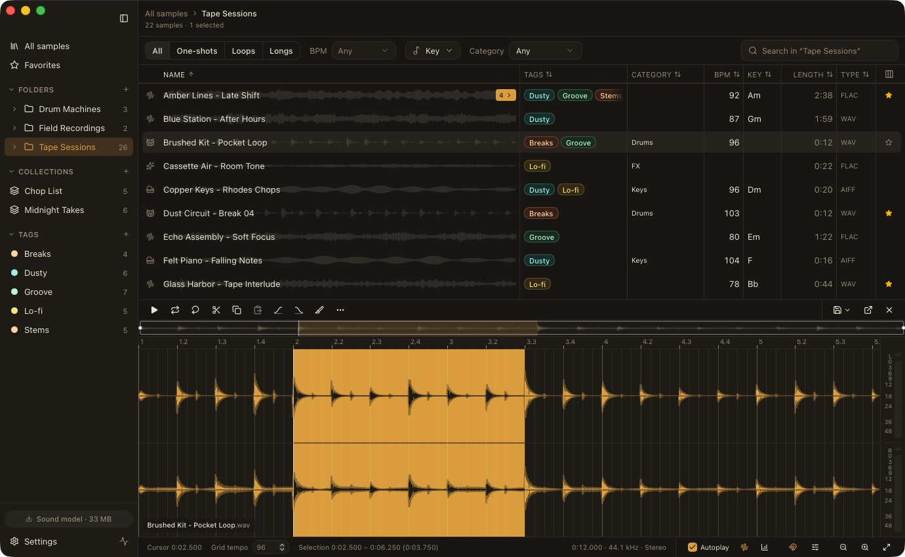
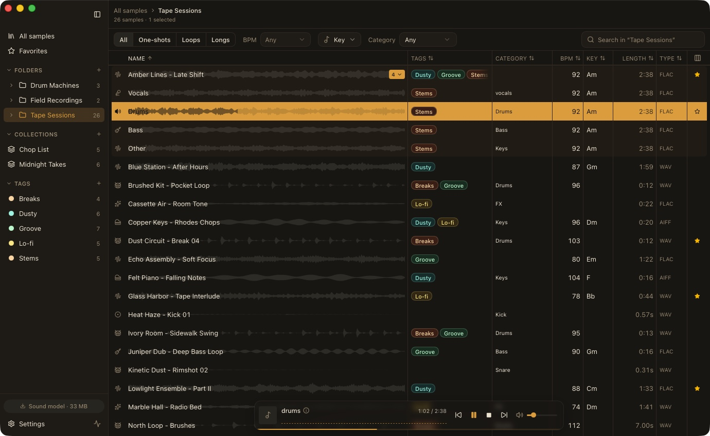

# Fonicca user guide

Fonicca is a desktop app for auditioning, organizing and editing local audio. It indexes your audio in its existing folders and keeps library data on your computer.

[Get started](#get-started) · [Browse and organize](#browse-and-organize) · [Preview audio](#preview-audio) · [Edit and export](#edit-and-export) · [Separate stems](#separate-stems) · [Process audio](#process-audio) · [Manage your data](#manage-your-data) · [Shortcuts](#keyboard-shortcuts) · [Troubleshooting](#troubleshooting)

## Get started

1. [Install Fonicca for your platform](../README.md#installation). Open the app and click **+** beside **Folders**. Choose a folder containing audio files. Subfolders are indexed automatically.
2. Click the folder in the sidebar. Tracks appear as the scan progresses. Background analysis fills in properties such as BPM, key and loudness where available.
3. Click a track to listen in the floating mini-player. Double-click it to open the waveform editor below the library.
4. To export an excerpt, drag over the desired part of the waveform, then open the editor’s save menu and choose **Save selection…**. Pick a format, sample rate and destination.

Fonicca reads WAV, AIFF, FLAC, MP3, OGG, M4A and CAF. Decoding also depends on the codec inside the file.

## Browse and organize

- **Navigate folders.** Expand a folder in the sidebar to see its subfolders. The path at the top of the library lets you go back to a parent folder or **All samples**. Right-click a source folder for **Rescan** or **Remove from library**. Removing a source removes its entries from Fonicca’s index.
- **Search and filter.** The search field works within the current folder or view. Select **All samples** to search across the library. Filter by **One-shots**, **Loops** or **Longs**, or narrow by BPM range, key and category. Use the clear-filters button to reset the analysis filters.
- **Change the table.** Click a column header to sort. Drag an edge between headers to resize a column. The **Columns** button in the last header shows or hides fields and offers **Reset column widths**.
- **Mark favorites.** Click a row’s star or press **F**. Open **Favorites** in the sidebar to see the marked samples.
- **Group samples in collections.** Click **+** beside **Collections** to create one, or select tracks and open **Add to collection** in the context menu. A collection can reference tracks from several folders. To remove a track from a collection, open that collection and use **Remove from “…”**.

### Work with tags

| To do this | In the app |
| --- | --- |
| Add a tag to one track | Click **+** in its Tags cell. Pick an existing tag or type a name and choose **Create**. |
| Tag several tracks | Select the rows, then press **T** or choose **Add tag…** in the context menu. |
| Remove a tag from one track | Open **+** in that row’s Tags cell and click the tag under **On this sample**. |
| Browse tracks with a tag | Click the tag in a row or in the sidebar. |
| Rename, recolor or delete a tag | Use the tag’s controls in the sidebar. Deleting the tag there removes it from every track. |

### Find similar sounds

Install the **Sound model** from the sidebar or **Settings → Analysis**. Once analysis finishes for the sample, right-click it and choose **Find similar**, or press **S** with the row focused. Results are ranked by similarity.

## Preview audio

The floating mini-player shows the track, cover art when available, elapsed and total time, and playback progress. Use its controls to pause, stop, skip to the previous or next track, or change preview volume. Click or drag the progress bar to seek. Drag the body of the panel to reposition it.

- Click the row’s play button to toggle playback. With the default **From the click position** setting, clicking a loaded waveform seeks to that point. **Settings → Audio → Clicking a track** offers other starting behaviors.
- Use the up and down arrows to move through the library. **Settings → Audio → Autoplay** controls whether moving focus with the keyboard starts a preview.
- Click **ⓘ** beside the playing track’s name to see its metadata, format, sample rate, peak level, loudness and other available details. Use **Edit** inside the popover to change supported metadata.
- Drag a track row, or a selection of rows, into a DAW that accepts file drops. Fonicca drags the source files at their saved levels.

## Edit and export

Double-click a track or choose **Edit…** from its context menu. The editor opens below the library with its own transport. Use **Open editor in a separate window** in the editor toolbar for a standalone view.

1. Click the waveform to place the cursor. Drag to select a range.
2. Press **Space** with the editor focused to hear the selected range or play from the cursor. Turn on **Loop** to repeat a selection while auditioning it. Use **Loop points** to mark a loop for WAV export.
3. Use the toolbar for cut, copy, paste, crop and fades. Open **More tools** or the waveform context menu for further actions such as gain, normalization, reversing, pitch and timing. Use **Undo** or **Redo** to move through edits.
4. Use the overview strip to navigate the file. The **View** menu switches the grid between bars and beats, time, and off. Adjust **Grid tempo** when you need a different timing grid.

### Save, slice or replace

| Save menu command | Result |
| --- | --- |
| **Save** | For a first save, Fonicca asks for a destination. Later saves update that file at its last export rate. |
| **Save as…** | Writes the full edited track to a chosen location and lets you set the format and sample rate. |
| **Save selection…** | Exports only the selected waveform range as a new file. |
| **Save regions** | Exports each included slice as a separate WAV to a folder beside the track. |
| **Replace original…** | For eligible WAV files, writes the edit over the original after keeping a backup. |

You can export whole tracks and selections as WAV, MP3, OGG Vorbis, FLAC, AIFF, M4A (ALAC) or CAF. Choose WAV to carry loop points and slice markers into the exported file.

To make several clips from one track, press **M** at the cursor or double-click the ruler to add markers. You can also use the slicer to place markers automatically. Drag the markers to refine the boundaries, then choose **Save regions**. Option/Alt-click a region on the ruler to skip it during export.

## Separate stems

1. Right-click the original track and choose **Processing → Separate into stems…**.
2. Select **2 tracks** for vocals and instrumental, or **4 tracks** for vocals, drums, bass and other instruments.
3. Choose a **Separation model** and check **Output format**. Fonicca preselects the source format when supported, with WAV as the fallback. You can choose any of the seven audio export formats.
4. Check **Output folder**. By default, Fonicca creates a folder named for the track beside its original file. Set a different destination under **Settings → Analysis → Stem storage**.
5. Click **Separate** or **Download model and separate**. When processing finishes, click the numbered badge next to the original track to expand the group. Each stem can be previewed or edited separately.

Stem separation accepts mono or stereo input up to 10 minutes and writes stereo files at 44.1 kHz. Model downloads use the internet and separation runs on your computer. The dialog shows the download size and model details. See the [model and dependency notes](dependencies.md) for usage terms.

## Process audio

| Workflow | Where to start | Result |
| --- | --- | --- |
| Batch processing | Select tracks and choose **Processing → Process…**. | Apply a shared recipe for silence trimming, DC offset removal, fades, peak or LUFS normalization, or conversion to WAV with chosen channel, sample rate and bit depth settings. Save a preset or use a filename template for repeated jobs. |
| Music restoration | Choose **Processing → Restore with Apollo…**. | Restore music affected by lossy compression and write a separate 44.1 kHz, 32-bit float WAV. |
| Audio to MIDI | Choose **Processing → Export MIDI…**, or use **Export MIDI…** in the editor for the selection or whole track. | Basic Pitch detects notes in melodic audio and writes a MIDI file for a DAW. |

For batch output, choose **A folder** to write separate files. **Replace the originals** is available for WAV input and stores a backup before replacing each file. Apollo and Basic Pitch accept mono or stereo input up to 10 minutes. Downloaded models are managed under **Settings → Analysis → Models**.

## Manage your data

### Duplicates and hidden files

Open **Duplicates** in the sidebar to review identical files. Pick which copy to keep or set a rule such as **Shortest path**. Use **Hide from library** to remove extra copies from the index, or **Move to Trash** to send the files to the operating system’s Trash. Review selected groups before applying the action. Tags, favorites and collection membership from resolved copies are combined on the copy you keep.

Restore a hidden entry from **Settings → Library → Hidden files → Unhide**. Restore a trashed file through the operating system, then rescan the source folder if needed.

### Export favorites, tags and collections

Open **Settings → Library → Your data → Export…** to save these library assignments as JSON. Keep that file with a separate copy of your audio if you are moving to another machine. On the new installation, add and scan the audio folders first, then choose **Import…**. Import merges assignments into the library and matches audio by path first, then by content.

Find the library database, settings file and model storage paths under **Settings → About → Storage**. To choose the interface palette, open **Settings → Themes**. A fresh installation uses **Tape**, while **Settings → General → Appearance** controls its light or dark variant.

## Keyboard shortcuts

Use **Command** on macOS or **Ctrl** on Windows and Linux for the commands below.

| In the library | Action |
| --- | --- |
| Up / Down | Move focus. Add **Shift** to extend the selection. |
| Space | Play or pause the focused track. |
| Esc | Stop the current preview, or leave the search field. |
| Command/Ctrl + A | Select all results in the current view. |
| Command/Ctrl + F | Focus search. |
| F / T | Toggle favorite / open the tag picker. |
| E / I / S | Open the embedded editor / edit track information / find similar sounds. |

| In the editor | Action |
| --- | --- |
| Space | Toggle editor playback. |
| Command/Ctrl + Z | Undo. Add **Shift** to redo. |
| Command/Ctrl + S | Save. Add **Shift** for **Save as…**. |
| M | Add a marker at the cursor or at both ends of a selection. |
| 1–9 / Shift + 1–9 | Play regions 1–9 / 10–18. |
| L / Shift + L | Toggle looping / set or clear loop points. |

## Troubleshooting

| Symptom | What to check |
| --- | --- |
| A new track is missing | Clear search and filters, open the source folder and use **Rescan**. If you previously hid the file, check **Settings → Library → Hidden files**. For an external drive, reconnect it at the original path before rescanning. |
| BPM, key or category is blank | Check progress in **Settings → Analysis** and resume analysis if it is paused. Tempo and key depend on the material. The optional **Sound model** helps categorize audio when the filename gives little information. |
| Find similar is unavailable | Download the **Sound model** and wait for analysis to finish. |
| Preview has no sound | Check the mini-player volume and **Settings → Audio → Output device**. Refresh devices after reconnecting an audio interface, then start playback again. |
| Stem separation, restoration or MIDI export fails | Check that the source is mono or stereo and up to 10 minutes, that the model is installed and that the output location is writable. To work with a portion of a longer recording, export a selection first. |

For help with an issue, include the Fonicca version from **Settings → About**, your operating system, the audio format and steps to reproduce it. [GitHub issues](https://github.com/dremchee/fonicca/issues)
